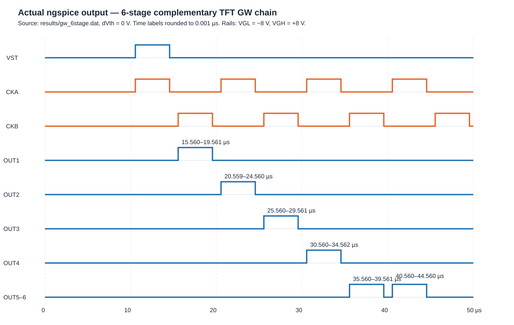
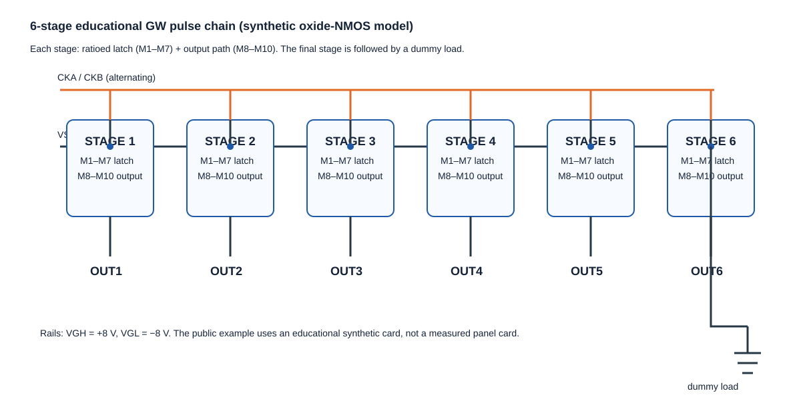

# GW 예제 실행 결과

실행일: 2026-10-31  
명령: `bash scripts/run_gw_example.sh <dVth>`

## 조건

- ngspice OSDI + OpenVAF로 `models/tft.va`를 컴파일했다.
- 6단 ratioed NMOS GW 체인, VGH = +8 V, VGL = -8 V.
- 문턱전압 `dVth`는 합성 NMOS 카드의 기준값 +0.595 V에 더하는 값이다.
- 판정은 각 OUT이 자기 슬롯에서 정확히 한 펄스를 내는지다.

## 실제 결과

| dVth | OUT1 | OUT2 | OUT3 | OUT4 | OUT5 | OUT6 | 전체 |
|---:|:---:|:---:|:---:|:---:|:---:|:---:|:---:|
| -1.6 V | PASS | PASS | PASS | PASS | PASS | PASS | PASS |
| 0.0 V | PASS | PASS | PASS | PASS | PASS | PASS | PASS |
| +0.8 V | PASS | PASS | PASS | PASS | PASS | PASS | PASS |

실제 파형은 아래 그림처럼 한 프레임에서 OUT1→OUT6 순서로 하나씩 나오는지를 본다.

## 해석

이 결과는 Im 외 JSID 논문의 -1.6 V ~ +0.8 V 안정 동작 주장을 **검증하거나 반박하는
결과가 아니다.** 두 회로는 다르다. 이 저장소는 공개 특허의 래치+출력 경로에서 출발한
교육용 complementary-TFT 체인이고, 논문은 회로도가 공개 초록에 포함되지 않은 blocking-structure
다중 출력 회로다.

확인할 수 있는 사실은 좁다.

- 이 합성 카드·이 토폴로지에서는 `-1.6 V`, 기준, `+0.8 V`에서 6단 순차 펄스가 통과했다.
- 따라서 논문과 같은 범위를 말하려면 논문 회로도, 동일한 TFT 모델, 부하, 클록 조건과
  전력 측정식을 확보한 뒤 별도 재현해야 한다.

자동 검증은 `circuits/gw_6stage.py`의 `evaluate()`에 있다.
